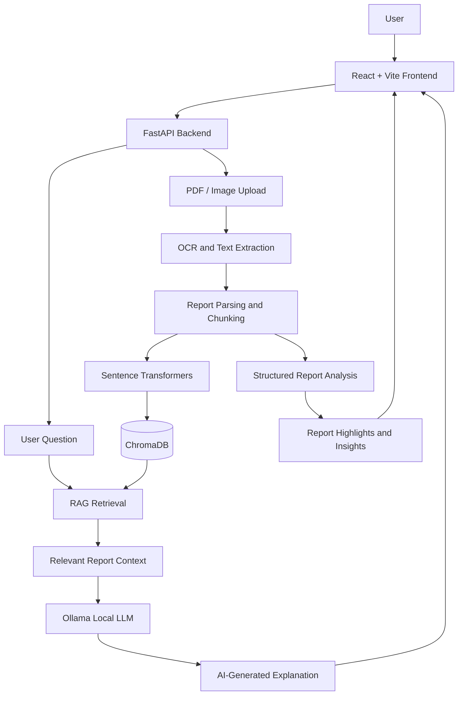

# 🩺 MediMind AI – AI-Powered Healthcare Report Assistant

**Understand your health reports. Ask questions. Make informed decisions.**

MediMind AI is an AI-powered healthcare report assistant designed to help users understand their medical reports through intelligent document processing, OCR, Retrieval-Augmented Generation (RAG), and locally running Large Language Models (LLMs).

Users can upload medical reports in PDF and image formats, extract important health parameters, explore report highlights, and interact with an AI assistant to understand medical terminology and test results in simple language.

MediMind aims to make medical information more understandable and accessible through an interactive, multilingual, and privacy-conscious application.

---

## 🌟 Key Features

| Feature | Description |
|---|---|
| 📄 Medical Report Upload | Upload medical reports in PDF, JPG, JPEG, and PNG formats. |
| 🔍 OCR Processing | Extract text from scanned reports and medical images using OCR. |
| 🧠 AI-Powered Report Analysis | Process extracted report information and generate understandable report highlights. |
| 📊 Health Parameter Extraction | Identify measurements, values, units, and available reference ranges. |
| 🟢 Report Highlights | Present results within and outside the report's reference ranges using clear visual indicators. |
| ⚠️ Attention Indicators | Highlight potentially important findings when supported by available report information. |
| 💬 Medical AI Assistant | Ask general medical questions and questions related to uploaded reports. |
| 📚 RAG-Based Q&A | Retrieve relevant information from uploaded reports to generate context-aware responses. |
| 📈 Report History | Access previously uploaded reports and their associated information. |
| 🌐 Multilingual Support | Interact with MediMind in English, Kannada, and Hindi. |
| 🔊 Voice Interaction | Voice input and spoken responses where browser and system speech support are available. |
| 💡 MediMind Insights | Present understandable health-related explanations and general educational thoughts. |

---

## 🏗️ System Architecture

MediMind follows a full-stack architecture integrating document processing, vector retrieval, and local AI inference.



### How It Works

1. **Report Upload:** The user uploads a medical report through the React frontend.
2. **Document Processing:** FastAPI receives the document and processes the uploaded PDF or image.
3. **Text Extraction:** Text is extracted using document parsing and OCR techniques.
4. **Text Chunking:** Extracted content is divided into smaller meaningful sections.
5. **Embedding Generation:** Sentence Transformers convert text chunks into vector embeddings.
6. **Vector Storage:** ChromaDB stores embeddings and associated document information.
7. **Question Processing:** When the user asks a question, relevant report content is retrieved using semantic search.
8. **AI Response Generation:** Retrieved context is passed to the local Ollama LLM to generate an understandable response.
9. **Frontend Display:** The response and available report insights are presented through the interactive interface.

---

## 🧰 Technology Stack

| Category | Technologies |
|---|---|
| Frontend | React.js, Vite, JavaScript, HTML, CSS |
| Backend | Python, FastAPI |
| AI / LLM | Ollama, Gemma 3 (4B) |
| RAG Framework | Retrieval-Augmented Generation |
| Vector Database | ChromaDB |
| Embeddings | Sentence Transformers |
| OCR | EasyOCR |
| Document Processing | PyMuPDF, pypdf, Pillow, OpenCV |
| Testing | Pytest |
| Development Tools | VS Code, Git, GitHub |

---

## 🧠 AI and RAG Implementation

MediMind combines semantic retrieval with locally executed language models.

**1. Document Understanding**

- Extracts text from uploaded medical documents.
- Supports scanned documents through OCR.
- Preserves available report sections and measurement information.

**2. Semantic Search**

- Uses Sentence Transformers to generate embeddings.
- Stores document representations in ChromaDB.
- Retrieves relevant report sections based on user questions.

**3. Context-Aware Responses**

- Uses retrieved report information as context.
- Supports report-specific questions and general medical Q&A.
- Maintains conversation context for follow-up questions.

**4. Local LLM Integration**

- Uses Ollama to run language models locally.
- Generates explanations using the retrieved information.
- Reduces dependence on external paid LLM APIs.

---

## 🌐 Supported Languages

MediMind is designed to support three languages:

- 🇬🇧 English
- ಕನ್ನಡ Kannada
- हिन्दी Hindi

The selected language is used for report explanations and conversational interactions.

---

## 🚀 Running the Project Locally

### Prerequisites

Install the following:

- Python 3.11
- Node.js and npm
- Git
- Ollama

### 1. Clone the Repository

```bash
git clone https://github.com/YOUR_USERNAME/MediMind-AI.git
cd MediMind-AI
```

### 2. Create and Activate a Python Virtual Environment

```bash
py -3.11 -m venv .venv
```

For Windows PowerShell:

```powershell
.venv\Scripts\Activate.ps1
```

### 3. Install Backend Dependencies

```bash
pip install -r requirements.txt
```

Use the dependency file provided in the repository if its location differs.

### 4. Set Up Ollama

Install Ollama and download the model:

```bash
ollama pull gemma3:4b
```

Ensure the Ollama service is running before starting the backend.

### 5. Start the FastAPI Backend

From the project root:

```bash
uvicorn backend.main:app --reload --host 127.0.0.1 --port 8000
```

Backend:

`http://127.0.0.1:8000`

API documentation:

`http://127.0.0.1:8000/docs`

### 6. Start the React Frontend

Open another terminal:

```bash
cd frontend
npm install
npm run dev
```

Frontend:

`http://localhost:5173`

---

## 📁 Project Structure

```text
MediMind-AI/
│
├── backend/
│   └── main.py                 # FastAPI application entry point
│
├── frontend/
│   ├── src/
│   │   ├── components/         # Reusable UI components
│   │   ├── services/           # API integration
│   │   ├── pages/              # Application pages
│   │   └── assets/             # Frontend assets
│   ├── package.json
│   └── vite.config.js
│
├── tests/                      # Backend tests
├── requirements.txt            # Python dependencies
├── .gitignore
└── README.md
```

*The directory structure above is a high-level overview; individual folders may vary as the project evolves.*

---

## 🧪 Testing

Run backend tests:

```bash
python -m pytest -v
```

Run frontend lint checks:

```bash
cd frontend
npm run lint
```

Create a production frontend build:

```bash
npm run build
```

---

## 🔒 Privacy and Medical Safety

MediMind is designed around local AI processing using Ollama and locally stored vector data.

Important considerations:

- Medical reports contain sensitive information. Handle uploaded documents responsibly.
- AI-generated explanations may contain inaccuracies.
- Extracted values and reference ranges should always be checked against the original report.
- MediMind does not provide a medical diagnosis or replace professional medical advice.
- Users should consult qualified healthcare professionals for medical decisions.

**Disclaimer:** MediMind AI is an educational healthcare report understanding tool. It is not intended to diagnose, treat, or replace consultation with a qualified medical professional.

---

## 🔮 Future Enhancements

- Improved medical parameter extraction and validation.
- More accurate report-specific reference-range mapping.
- Enhanced historical health trend visualization.
- Improved multilingual medical explanations.
- Expanded voice interaction capabilities.
- Better support for additional medical document formats.
- More comprehensive testing and reliability improvements.

---

## 👩‍💻 About the Project

MediMind AI is a full-stack AI project developed to explore the practical application of Artificial Intelligence, Natural Language Processing, OCR, semantic search, and Retrieval-Augmented Generation in healthcare document understanding.

The project focuses on making complex medical report information easier to understand through an interactive AI-powered experience.

**Built with Python, React, FastAPI, ChromaDB, Sentence Transformers, and Ollama.**

---

⭐ If you find this project interesting, consider giving the repository a star!
